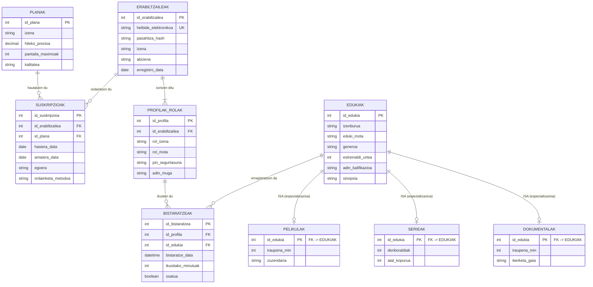

# Datu-Baseak: Streaming Plataforma (Artaburu Prime Video)

---

## 1. Egoeraren Analisia eta DBKS-aren Onurak

Proiektu honetan, **Artaburu Prime Video** streaming plataforma kudeatzeko datu-base erlazional bat diseinatu eta inplementatu da. Enpresak datuak fitxategi lauetan (Excel, CSV edo testu-fitxategietan) gorde beharrean, **Datu-Baseak Kudeatzeko Sistema (DBKS / RDBMS)** bat erabiltzea erabaki du, ondorengo onura nagusiak lortuz:

1. **Erredundantzia eza eta koherentzia:** Datu bakoitza behin bakarrik gordetzen da. Adibidez, harpidetza-plan baten prezioa aldatzen denean (`hileko_prezioa`), `PLANAK` taulan bakarrik eguneratzen da, eta ez milaka bezeroren fitxategietan banan-banan.
2. **Osotasun erreferentziala:** DBKS-ak bermatzen du ez dela umezurtz geratzen den daturik egongo. Ezin da existitzen ez den eduki baten bistaratzerik gorde.
3. **Konkurrentzia eta transakzioak:** Erabiltzaile askok aldi berean sar daitezke plataformara datuak hondatzeko arriskurik gabe (ACID propietateak).
4. **Segurtasuna eta baimenak:** Pasahitzak babestuta mantentzen dira eta datuetarako sarbidea rol bidez kontrolatzen da.

> **Zer gertatuko litzateke datuak modu ez-egokian gordeko balira?**  
> Fitxategi arruntetan edo normalizatu gabeko tauletan, anomalia larriak gertatuko lirateke:
> - *Txertatze-anomaliak:* Ezingo litzateke plan berririk erregistratu bezerorik ez badago.
> - *Aldaketa-anomaliak:* Datu bat leku batean aldatu eta beste batean desfasatuta geratzea.
> - *Ezabatze-anomaliak:* Bezero bat ezabatzean, kontratatuta zuen planaren informazio orokorra ustekabean ezabatzea.

---

## 2. Entitate/Erlazio (E-R) Diseinua eta ISA Hierarkia

Kasuistika aztertu ondoren, bi diseinu alternatibo baloratu dira:
- **A Aukera (Baztertua):** Eduki guztiak taula bakar batean biltzea. Diseinu honek eremu nulo (NULL) ugari sortzen ditu; adibidez, pelikuletan `denboraldiak` eremua beti hutsik geratuko litzateke.
- **B Aukera (Aukeratua eta Inplementatua):** **ISA (Espezializazio / Herentzia) hierarkia** aplikatzea. `EDUKIAK` entitate nagusiak ezaugarri orokorrak biltzen ditu, eta hiru azpientitate espezifiko sortzen dira: `PELIKULAK`, `SERIEAK` eta `DOKUMENTALAK`.

### ISA Hierarkiaren Ezaugarriak:
* **Totala (T):** Plataformako eduki orok hiru azpimota horietako baten parte izan behar du ezinbestean.
* **Disjuntua (D):** Mota bakoitza esklusiboa da; eduki bat ezin da aldi berean pelikula eta serie izan.
* **Gakoen herentzia:** Azpimotek `id_edukia` gakoa heredatzen dute; eremu hori aldi berean da **Gako Nagusia (PK)** eta **Kanpo Gakoa (FK)**.

---

## 3. Eredu Erlazionala (Taulak)

E-R diagramatik lortutako eredu erlazional normalizatua (8 taula):

1. **PLANAK** (<ins>id_plana</ins>, izena, hileko_prezioa, pantaila_maximoak, kalitatea)
2. **ERABILTZAILEAK** (<ins>id_erabiltzailea</ins>, helbide_elektronikoa, pasahitza_hash, izena, abizena, erregistro_data)
3. **SUSKRIPZIOAK** (<ins>id_suskripzioa</ins>, *id_erabiltzailea*, *id_plana*, hasiera_data, amaiera_data, egoera, ordainketa_metodoa)
   - *FK id_erabiltzailea* &rarr; `ERABILTZAILEAK(id_erabiltzailea)`
   - *FK id_plana* &rarr; `PLANAK(id_plana)`
4. **PROFILAK_ROLAK** (<ins>id_profila</ins>, *id_erabiltzailea*, rol_izena, rol_mota, pin_segurtasuna, adin_muga)
   - *FK id_erabiltzailea* &rarr; `ERABILTZAILEAK(id_erabiltzailea)`
5. **EDUKIAK** (<ins>id_edukia</ins>, izenburua, eduki_mota, generoa, estreinaldi_urtea, adin_kalifikazioa, sinopsia)
6. **PELIKULAK** (<ins>*id_edukia*</ins>, iraupena_min, zuzendaria)
   - *PK/FK id_edukia* &rarr; `EDUKIAK(id_edukia)`
7. **SERIEAK** (<ins>*id_edukia*</ins>, denboraldiak, atal_kopurua)
   - *PK/FK id_edukia* &rarr; `EDUKIAK(id_edukia)`
8. **DOKUMENTALAK** (<ins>*id_edukia*</ins>, iraupena_min, ikerketa_gaia)
   - *PK/FK id_edukia* &rarr; `EDUKIAK(id_edukia)`
9. **BISTARATZEAK** (<ins>id_bistaratzea</ins>, *id_profila*, *id_edukia*, bistaratze_data, ikusitako_minutuak, osatua)
   - *FK id_profila* &rarr; `PROFILAK_ROLAK(id_profila)`
   - *FK id_edukia* &rarr; `EDUKIAK(id_edukia)`

---

## 4. Normalizazioa (3. Forma Normala - 3FN)

- **1. Forma Normala (1FN):** Taula guztietako eremuak atomikoak dira. Ez dago errepikatutako talderik ezta balio konposaturik. Taula guztiek dute Gako Nagusi (PK) bakarra.
- **2. Forma Normala (2FN):** 1FN betetzen da eta gako ez diren atributu guztiek mendekotasun funtzional osoa dute gako nagusiarekiko (ez dago mendekotasun partzialik).
- **3. Forma Normala (3FN):** 2FN betetzen da eta ez dago mendekotasun iragankorrik (trantsitiborik). Gako ez diren atributuek ez dute beste atributu ez-gako baten menpekotasunik. Adibidez, planaren ezaugarriak ez dira bezeroan edo harpidetzan errepikatzen, `PLANAK` taulan soilik daude.

---

## 5. Murrizketak eta Access-eko Inplementazioa

### Balidazio Arauak (Validation Rules):
- `PLANAK.hileko_prezioa >= 0`
- `PLANAK.pantaila_maximoak >= 1`
- `EDUKIAK.estreinaldi_urtea >= 1895`
- `BISTARATZEAK.bistaratze_data <= Now()`
- `PROFILAK_ROLAK.rol_mota IN ('Infantila', 'Pertsonala', 'Familiarra')`

### Datuak Txertatzeko Ordena:
1. `PLANAK` eta `EDUKIAK` (guraso-taula independenteak)
2. `PELIKULAK`, `SERIEAK`, `DOKUMENTALAK` (azpimotak)
3. `ERABILTZAILEAK`
4. `SUSKRIPZIOAK` eta `PROFILAK_ROLAK`
5. `BISTARATZEAK`

### Datuak Ezabatzeko Ordena:
Alderantzizko ordenean ezabatu behar dira umezurtzik ez sortzeko: Lehenengo `BISTARATZEAK`, ondoren `PROFILAK_ROLAK` eta `SUSKRIPZIOAK`, eta azkenik bezeroak edo edukiak.
