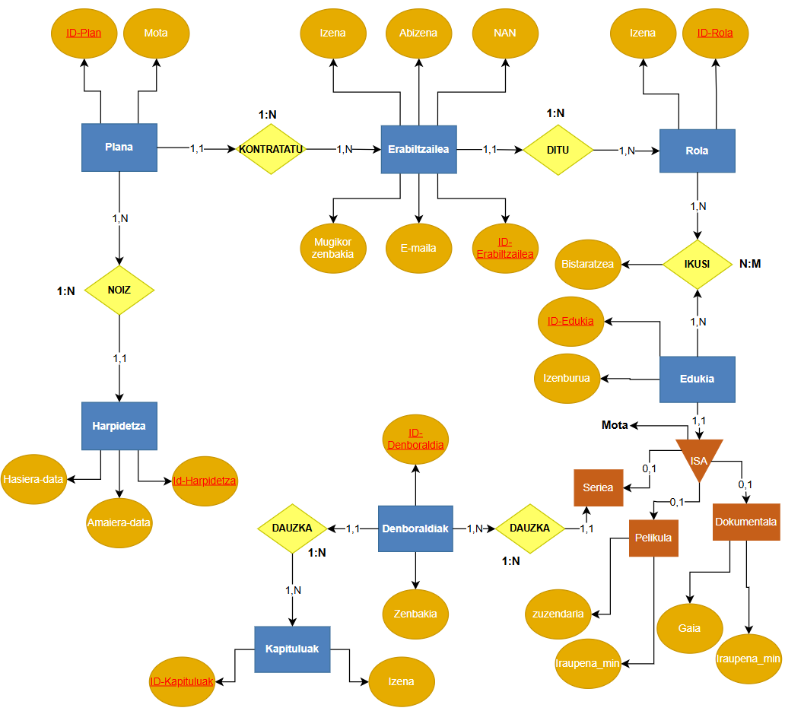
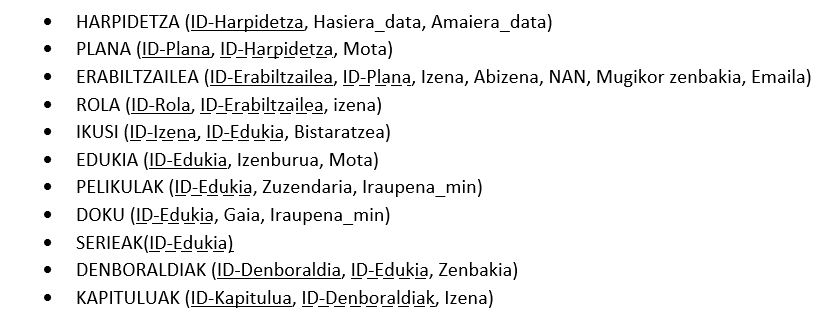
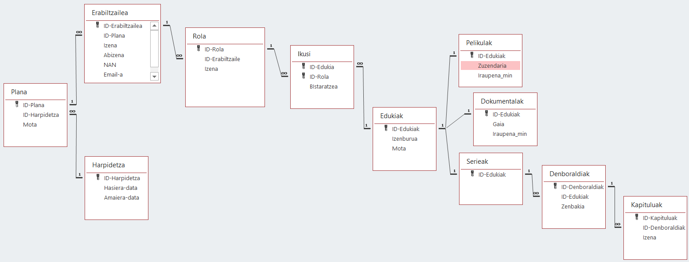
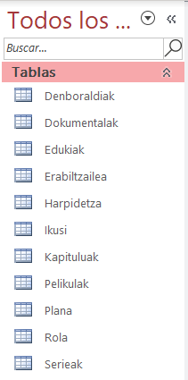

## 1. E/R sortu:
Streaming plataforma ezagun batek bere datu-basea berritu nahi du. Honako hau da lana egiteko jaso dugun informazioa:

Erabiltzaileei buruz honako datu hauek gorde nahi dira: ID-Erabiltzailea, izena, abizena, NAN, telefonoa eta e-maila.

Plataformak hainbat plan desberdin eskaintzen ditu, eta bakoitzak bere ID-Plana eta mota (Oinarrizkoa iragarkiekin, oinarrizkoa eta premiuma) dute. Erabiltzaile bakoitzak gutxienez plan bat kontratatu behar du zerbitzua erabiltzeko eta, noski, plan bakoitza erabiltzaile askok kontratatuko dute.

Plan bakoitzak harpidetza bakarra izaten du lotuta, eta plan bakoitzari gutxienez harpidetza bat dagokio. Harpidetza bakoitzak bere ID-Harpidetza, hasiera-data eta amaiera-data izango ditu. Harpidetza bakoitza plan bakar bat edo gehiagori egongo da beti lotuta.

Erabiltzaile bakoitzak bere kontuaren barruan Rol bat baina gehiago kudeatu ditzake. Rolei buruz informazio hau dugu: ID-Rola eta mota (Pertsonala, Familiarra eta Infantila). Rol bakoitza erabiltzaile bakar bati dagokio.

Plataforman mota askotako edukiak daude eskuragarri. Eduki bakoitzari buruz bere ID-Edukia eta izenburua jakin nahi dira. Edukiak hiru motatakoak izan daitezke: Serieak, Pelikulak edo Dokumentalak. Pelikulak barruan zuzendaria eta iraupena_min eta Dokumental-aren barruan gaia (Natura eta animaliak, kirolak, gizartea eta kultura, musika eta artea, biografiak eta krimenak eta ikerketak) eta iraupena_min egon behar dute.

Rol bakoitzak edukiak bistaratu ditzake. Rol batek gutxienez eduki bat ikusiko du, eta eduki bakoitza gutxienez rol batek baino gehiago ikusiko du. Rol batek eduki bat ikusten duen bakoitzean, bistaratze hori erregistratu nahi da, ikustaldi horren informazioa gordez.

Azkenik, serieek egitura berezia dute. Serie bakoitzak denboraldi asko izango ditu. Denboraldi bakoitza serie bakar batekoa da, eta ID-Denboraldia kodeaz gain, bere zenbakia gordetzen da. Era berean, denboraldi bakoitzak gutxienez kapitulu asko izango ditu, eta kapitulu bakoitza denboraldi zehatz bati dagokio.

## 2. Eredu Erlazionala:

# 3. Datu-basearen normalizazioa

## 3.1 HARPIDETZA

**HARPIDETZA** (`ID-Harpidetza`, `Hasiera_data`, `Amaiera_data`)

- **1FN?** Bai, ez dago errepikapenik. Datuak atomikoak dira.
- **2FN?** Bai, dependentzia partziala ez dagoelako.
- **3FN?** Bai, dependentzia funtzional transitiboa ez dagoelako.

## 3.2 PLANA

**PLANA** (`ID-Plana`, `ID-Harpidetza`, `Mota`)

- **1FN?** Bai, ez dago errepikapenik. Datuak atomikoak dira.
- **2FN?** Ez, dependentzia partziala dagoelako.

Deskonposizioa:

- `ID-Plana` → `Mota`
- **PLANA** (`ID-Plana`, `ID-Harpidetza`)

- **3FN?** Bai, dependentzia funtzional transitiboa ez dagoelako.

## 3.3 ERABILTZAILEA

**ERABILTZAILEA** (`ID-Erabiltzailea`, `ID-Plana`, `Izena`, `Abizena`, `NAN`, `Mugikor zenbakia`, `E-maila`)

- **1FN?** Bai, ez dago errepikapenik. Datuak atomikoak dira.
- **2FN?** Ez, dependentzia partziala dagoelako.

Deskonposizioa:

- `ID-Erabiltzailea` → (`Izena`, `Abizena`, `NAN`, `Mugikor zenbakia`, `E-maila`)
- **ERABILTZAILEA** (`ID-Erabiltzailea`, `ID-Plana`)

- **3FN?** Bai, dependentzia funtzional transitiboa ez dagoelako.

## 3.4 ROLA

**ROLA** (`ID-Rola`, `ID-Erabiltzailea`, `Izena`)

- **1FN?** Bai, ez dago errepikapenik. Datuak atomikoak dira.
- **2FN?** Ez, dependentzia partziala dagoelako.

Deskonposizioa:

- `ID-Rola` → `Izena`
- **ROLA** (`ID-Rola`, `ID-Erabiltzailea`)

- **3FN?** Bai, dependentzia funtzional transitiboa ez dagoelako.

## 3.5 IKUSI

**IKUSI** (`ID-Izena`, `ID-Edukia`, `Bistaratzea`)

- **1FN?** Bai, ez dago errepikapenik. Datuak atomikoak dira.
- **2FN?** Ez, dependentzia partziala dagoelako.

Deskonposizioa:

- **IKUSI** (`ID-Izena`, `ID-Edukia`, `Bistaratzea`)

- **3FN?** Bai, dependentzia funtzional transitiboa ez dagoelako.

## 3.6 EDUKIA

**EDUKIA** (`ID-Edukia`, `Izenburua`, `Mota`)

- **1FN?** Bai, ez dago errepikapenik. Datuak atomikoak dira.
- **2FN?** Bai, dependentzia partziala ez dagoelako.
- **3FN?** Bai, dependentzia funtzional transitiboa ez dagoelako.

## 3.7 PELIKULAK

**PELIKULAK** (`Zuzendaria`, `Iraupena_min`)

- `id`: **EDUKI**-ren kanpo-gakoa (`id`)
- **1FN?** Bai, ez dago errepikapenik. Datuak atomikoak dira.
- **2FN?** Bai, dependentzia partziala ez dagoelako.
- **3FN?** Bai, dependentzia funtzional transitiboa ez dagoelako.

## 3.8 DOKU

**DOKU** (`Gaia`, `Iraupena_min`)

- `id`: **EDUKI**-ren kanpo-gakoa (`id`)
- **1FN?** Bai, ez dago errepikapenik. Datuak atomikoak dira.
- **2FN?** Bai, dependentzia partziala ez dagoelako.
- **3FN?** Bai, dependentzia funtzional transitiboa ez dagoelako.

## 3.9 SERIEAK

**SERIEAK**

- `id`: **EDUKI**-ren kanpo-gakoa (`id`)
- **1FN?** Bai, ez dago errepikapenik. Datuak atomikoak dira.
- **2FN?** Bai, dependentzia partziala ez dagoelako.
- **3FN?** Bai, dependentzia funtzional transitiboa ez dagoelako.

## 3.10 DENBORALDIAK

**DENBORALDIAK** (`ID-Denboraldia`, `ID-Edukia`, `Zenbakia`)

- **1FN?** Bai, ez dago errepikapenik. Datuak atomikoak dira.
- **2FN?** Ez, dependentzia partziala dagoelako.

Deskonposizioa:

- `ID-Denboraldia` → `Zenbakia`
- **DENBORALDIAK** (`ID-Denboraldia`, `ID-Edukia`)

- **3FN?** Bai, dependentzia funtzional transitiboa ez dagoelako.

## 3.11 KAPITULUAK

**KAPITULUAK** (`ID-Kapitulua`, `ID-Denboraldiak`, `Izena`)

- **1FN?** Bai, ez dago errepikapenik. Datuak atomikoak dira.
- **2FN?** Ez, dependentzia partziala dagoelako.

Deskonposizioa:

- `ID-Kapitulua` → `Izena`
- **KAPITULUAK** (`ID-Kapitulua`, `ID-Denboraldiak`)

- **3FN?** Bai, dependentzia funtzional transitiboa ez dagoelako.

# 4. Taulak eta haien atributuak

## 4.1 HARPIDETZA

- `ID-HARPIDETZA` — Gako nagusia (PK)
- `Hasiera_data`
- `Amaiera_data`

## 4.2 PLANA

- `ID-PLANA` — Gako nagusia (PK)
- `Mota`

## 4.3 ERABILTZAILEA

- `ID-Erabiltzailea` — Gako nagusia (PK)
- `Izena`
- `Abizena`
- `NAN`
- `Mugikor zenbakia`
- `Email-a`

## 4.4 ROL

- `ID_ROLA` — Gako nagusia (PK)
- `Izena`

## 4.5 IKUSI

- `ID_IZENA` — Gako nagusia (PK)
- `Bistaratzea`

## 4.6 EDUKIA

- `ID_EDUKIA` — Gako nagusia (PK)
- `Izenburua`
- `Mota`

## 4.7 PELIKULAK

- `ID_EDUKIAK` — Gako nagusia (PK, heredatua)
- `Zuzendaria`
- `Iraupena_min`

## 4.8 DOKU

- `ID_EDUKIAK` — Gako nagusia (PK, heredatua)
- `Gaia`
- `Iraupena_min`

## 4.9 SERIEAK

- `ID_EDUKIAK` — Gako nagusia (PK, heredatua)

## 4.10 DENBORALDIAK

- `ID_DENBORALDIAK` — Gako nagusia (PK)
- `Zenbakia`

## 4.11 KAPITULUAK

- `ID_KAPITULUAK` — Gako nagusia (PK)
- `Izena`

# 5. Taulen gako nagusiak (PK) eta kanpo-gakoak (FK)

- **Gako nagusia (PK):** taula bateko erregistro bakoitza modu bakarrean identifikatzeko erabiltzen da. Ezin da errepikatu.
- **Kanpo-gakoa (FK):** beste taula bateko gako nagusiarekiko lotura egiteko erabiltzen da. Honi esker, taulen arteko erlazioak sor daitezke.

| Taula | Gako nagusia (PK) | Kanpo-gakoa(k) (FK) |
|---|---|---|
| HARPIDETZA | ID-HARPIDETZA | Bat ere ez |
| PLANA | ID-PLANA | ID-HARPIDETZA |
| ERABILTZAILEA | ID-ERABILTZAILEA | ID-PLANA |
| ROLA | ID-ROLA | ID-ERABILTZAILEA |
| IKUSI | ID-IZENA + ID-EDUKIAK | ID-IZENA, ID-EDUKIAK |
| EDUKIAK | ID-EDUKIAK | Bat ere ez |
| PELIKULAK | ID-EDUKIAK | ID-EDUKIAK |
| DOKU | ID-EDUKIAK | ID-EDUKIAK |
| SERIEAK | ID-EDUKIAK | ID-EDUKIAK |
| DENBORALDIAK | ID-DENBORALDIA | ID-EDUKIAK |
| KAPITULUAK | ID-KAPITULUA | ID-DENBORALDIA |

# 6. Taulen arteko erlazioak

- **1:1:** taula bateko erregistro bakoitza beste taulako erregistro bakar batekin lotzen da.
- **1:N:** taula bateko erregistro bat beste taulako hainbat erregistrotara lot daiteke.
- **N:M:** bi tauletako erregistroak elkarren artean hainbat aldiz lot daitezke.

| Erlazionatutako taulak | Lotutako atributuak | Erlazio mota |
|---|---|---|
| HARPIDETZA – PLANA | ID-HARPIDETZA | 1:N |
| PLANA – ERABILTZAILEA | ID-PLANA | 1:N |
| ERABILTZAILEA – ROLA | ID-ERABILTZAILEA | 1:N |
| ROLA – IKUSI | ID-ROLA | 1:N |
| EDUKIAK – IKUSI | ID-EDUKIAK | 1:N |
| EDUKIAK – PELIKULAK | ID-EDUKIAK | 1:1 |
| EDUKIAK – DOKU | ID-EDUKIAK | 1:1 |
| EDUKIAK – SERIEAK | ID-EDUKIAK | 1:1 |
| SERIEAK – DENBORALDIAK | ID-EDUKIAK | 1:N |
| DENBORALDIAK – KAPITULUAK | ID-DENBORALDIA | 1:N |

# 7. Access-eko taulen atributuen propietateak

## 7.1 HARPIDETZA

| Eremuaren izena | Datu mota | Propietateak |
|---|---|---|
| ID-HARPIDETZA | Autoenumerazioa | |
| Hasiera-data | Data/Ordua | Formatua: Fecha corta |
| Amaiera-data | Data/Ordua | Formatua: Fecha corta |

## 7.2 PLANA

| Eremuaren izena | Datu mota | Deskribapena |
|---|---|---|
| ID-PLANA | Autoenumerazioa | |
| ID-HARPIDETZA | Zenbakia | |
| Mota | Testu laburra | Bilaketa-laguntzailea: Estandar edo Premium |

## 7.3 ERABILTZAILEA

| Eremuaren izena | Datu mota | Deskribapena |
|---|---|---|
| ID-Erabiltzailea | Autoenumerazioa | |
| ID-PLANA | Zenbakia | |
| Izena | Testu laburra | Tamaño del campo = 30 |
| Abizena | Testu laburra | Tamaño del campo = 30 |
| NAN | Autonumerazioa | Mascara de entrada: `NIF (90000000>L;;_` |
| Email-a | Testu laburra | Regla de validación: `@` |
| Mugikor zenbakia | Testu laburra | Mascara de entrada: `\(009") "900\ 00\ 00;;_` |

## 7.4 PERFIL

| Eremuaren izena | Datu mota | Deskribapena |
|---|---|---|
| ID-ROLA | Autoenumerazioa | |
| ID-Erabiltzailea | Zenbakia | |
| Mota | Testu laburra | Tamaño del campo = 30 |

## 7.5 IKUSI

| Eremuaren izena | Datu mota | Deskribapena |
|---|---|---|
| ID_IZENA edo ID_Perfil | Zenbakia | |
| ID_EDUKIAK | Zenbakia | |
| Bistaratzea | Bai/Ez | |

## 7.6 EDUKIAK

| Eremuaren izena | Datu mota | Deskribapena |
|---|---|---|
| ID_EDUKIAK | Autoenumerazioa | |
| Izenburua | Testu laburra | Regla de validación: `*[A-Z]*` |
| Mota | Testu laburra | |

## 7.7 PELIKULAK

| Eremuaren izena | Datu mota | Deskribapena |
|---|---|---|
| ID_EDUKIAK | Zenbakia | |
| Zuzendaria | Testu laburra | Tamaño del campo = 30 |
| Iraupena_min | Data/Ordua | Mascara de entrada: `99:00:00;0;_` |

## 7.8 DOKUMENTALAK

| Eremuaren izena | Datu mota | Deskribapena |
|---|---|---|
| ID_EDUKIAK | Zenbakia | |
| Gaia | Testu laburra | |
| Iraupena_min | Data/Ordua | Mascara de entrada: `99:00:00;0;_` |

## 7.9 SERIEAK

| Eremuaren izena | Datu mota | Deskribapena |
|---|---|---|
| ID_EDUKIAK | Zenbakia | |

## 7.10 DENBORALDIAK

| Eremuaren izena | Datu mota | Deskribapena |
|---|---|---|
| ID_DENBORALDIA | Autonumerazioa | |
| ID_EDUKIAK | Zenbakia | |
| Zenbakia | Zenbakia | Valor predeterminado: 1 |

## 7.11 KAPITULUAK

| Eremuaren izena | Datu mota | Deskribapena |
|---|---|---|
| ID_KAPITULUA | Autonumerazioa | |
| ID_DENBORALDIA | Zenbakia | |
| Izena | Testu laburra | Tamaño del campo = 30; Regla de validación: `*[A-Z]*` |

