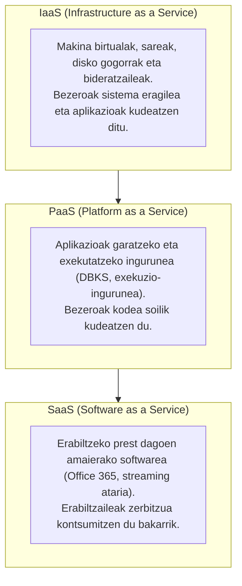

# Produkzio-Sektoreei Aplikatutako Digitalizazioa

---

## 1. Digitalizazioaren Kontzeptua

**Digitalizazioa** enpresa eta erakunde baten prozesu, zerbitzu eta baliabide tradizionalak teknologia digitalen bidez eraldatzea da, informazioa denbora errealean kudeatu, eraginkortasuna hobetu eta balio berria sortzeko helburuarekin.

Ekoizpen-sektoreetan, digitalizazioak datuetan oinarritutako erabakiak hartzea ahalbidetzen du, produktibitatea handituz, kostu operatiboak murriztuz eta bezeroei zerbitzu pertsonalizatuagoak eskainiz (adibidez, gure kasuan *Artaburu Prime Video* plataformaren bidez edukien banaketa digitala kudeatuz).

---

## 2. IT eta OT Inguruneen Arteko Desberdintasunak

Industria eta zerbitzu enpresetan bi ingurune teknologiko bereizgarri daude:

| Ezaugarria | IT (Information Technology) | OT (Operation Technology) |
| :--- | :--- | :--- |
| **Definizioa** | Informazioaren tratamendu, biltegiratze eta transmisio digitala kudeatzen du. | Fabrika eta instalazioetako ekipo fisikoak, makineria eta prozesuak kontrolatzen ditu. |
| **Helburu Nagusia** | Datuen konfidentzialtasuna, osotasuna eta eskuragarritasuna. | Eragiketen jarraitutasuna, segurtasun fisikoa eta denbora errealeko erantzuna. |
| **Tipiko diren Sailak** | Zuzendaritza, Finantzak, Salmentak, Giza Baliabideak, IT Saila. | Ekoizpen-planta, Mantentze-lanak, Kalitate-kontrola, Biltegia. |
| **Erabilitako Tresnak** | Ordenagailuak, zerbitzariak, datu-baseak, ERP, CRM, posta elektronikoa. | PLC-ak (automatikoki programagarriak), SCADA sistemak, HMI panelak, sentsoreak, CNC makinak, robotak. |
| **Ziklo-denborak** | Segundoak, minutuak edo orduak (onargarria da atzerapen txiki bat). | Milisegundoak edo mikrosegundoak (denbora erreala, geldialdiak galerak dakar). |

### IT eta OT Konbergentziaren Garrantzia
Industria 4.0 delakoan, bi mundu hauek elkartu egiten dira: fabrikako makinek (OT) sortutako datuak zuzenean hodeira edo kudeaketa sistemetara (IT) bidaltzen dira aztertu ahal izateko. Honek **zibersegurtasun erronka berriak** sortzen ditu, fabrikako makinak sarera konektatzean zibererasoen aurrean zaurgarriago bihurtzen baitira.

---

## 3. Teknologia Gaitzaile Digitalak (THD / TGD)

Enpresaren eraldaketa digitala bultzatzen duten 11 teknologia nagusiak aztertu dira:

1. **Cloud Computing (Hodei-Konputazioa):** Baliabide informatikoak (zerbitzariak, biltegiratzea, datu-baseak) Internet bidez kontsumitzeko eredua, tokiko azpiegitura fisikorik behar izan gabe.
2. **Zibersegurtasuna (Cybersecurity):** Sareak, zerbitzariak eta datu kritikoak lapurretatik, baimenik gabeko atzipenetatik eta eraso informatikoetatik babesteko teknikak.
3. **IIoT (Industrial Internet of Things):** Fabrikako makinei, sentsoreei eta gailuei konektibitatea ematea, denbora errealean informazioa jaso eta partekatzeko.
4. **Big Data eta Datuen Analitika:** Datu kopuru handiak (bolumena, abiadura eta aniztasuna) biltzea eta aztertzea enpresaren joerak eta hobekuntzak aurreikusteko.
5. **Adimen Artifiziala eta Machine Learning (AI/ML):** Datuetatik ikasten duten algoritmoak, erabaki automatizatuak hartzeko (adibidez, erabiltzaile bakoitzari gomendatutako filmak hautatzeko).
6. **Fabrikazio Gehigarria (3D Inprimaketa):** Piezak geruzaz geruza sortzea material plastiko edo metalikoen bidez, prototipo azkarrak eta pertsonalizatuak egiteko.
7. **Robotika Kolaboratiboa (Cobots):** Gizakiekin espazio berean segurtasunez lan egiten duten robot arinak, zeregin errepikakorrak eta arriskutsuak egiteko.
8. **Errealitate Birtuala eta Areagotua (VR / AR):** Mundu errealaren gainean informazio digitala gainjartzea mantentze-lanak, muntaketak edo langileen formakuntza errazteko.
9. **Biki Digitalak (Digital Twins):** Makina, lerro edo fabrika oso baten simulazio birtual zehatza, benetako ekoizpenean akatsak saihesteko eta errendimendua optimizatzeko.
10. **Blockchain (Bloke-katea):** Datu-erregistro banatu eta aldaezina, hornikuntza-katearen trazabilitatea eta transakzio seguruak bermatzeko bitartekaririk gabe.
11. **Sistema Txertatuak eta Edge Computing:** Konputazio-gaitasuna sentsorean edo tokiko gailuan bertan integratzea latentzia murrizteko.

---

## 4. Cloud Computing eta Arkitektura Banatua

### A. Hodei Mailak (Hedapen Ereduak)
- **Hodei Publikoa (Public Cloud):** Hornitzaile handiek (AWS, Microsoft Azure, Google Cloud) eskainitako zerbitzuak, edonork kontrata ditzakeenak. Kostu txikiagoa eta eskalagarritasun infinitua.
- **Hodei Pribatua (Private Cloud):** Enpresak bere zerbitzari eta zentro propioetan kudeatutako azpiegitura esklusiboa. Segurtasun eta kontrol maximoa, baina kostu altuagoa.
- **Hodei Hibridoa (Hybrid Cloud):** Bien arteko konbinazioa. Enpresak datu sentikorrak hodei pribatuan gordetzen ditu eta aplikazio publikoak edo aldaketa handiko kargak hodei publikora bideratzen ditu.

### B. Hodeiko Zerbitzu Ereduak


### C. Cloud, Fog, Mist eta Edge Computing
Datuen prozesamendua non egiten den kontuan hartuta, ondorengo banaketa hierarkikoa bereizten da:

```
[ CLOUD COMPUTING ]   ---> Datu-zentro urruna (prozesamendu ahalmen handiena, latentzia altua)
        |
  [ FOG COMPUTING ]   ---> Tokiko sareko zerbitzariak eta bideratzaileak (tarteko latentzia)
        |
  [ MIST COMPUTING ]  ---> Sentsore-sareen mikrokontrolagailuak (datu-bilketa eta aurre-iragazketa)
        |
  [ EDGE COMPUTING ]  ---> Gailuan bertan (latentzia zero, berehalako erantzuna denbora errealean)
```

1. **Cloud:** Datu globalak biltzeko, eredu astunak entrenatzeko eta historikoak gordetzeko.
2. **Fog:** Fabrikako sare lokalean datuak bateratzeko eta hodeira igo aurretik laburtzeko.
3. **Mist:** Sentsoreek berek oinarrizko eragiketak egitea (zarata kendu, neurketa anormalak baztertu).
4. **Edge:** Makinan edo kameran bertan prozesatzea (adibidez, pieza akastun bat ikusi eta milisegundotan makina gelditzea).

---

## 5. Proiektuaren Jarraipena: GitHub Projects

Proiektuaren plangintza digitalizatu eta talde-lana kudeatzeko **GitHub Projects** plataforma erabili da:
- **Metodologia:** Kanban taula interaktiboa.
- **Zutabeak:** `To Do` (Egin beharrekoak), `In Progress` (Garapen bidean), `In Review` (Egiaztatzen), `Done` (Amaituta).
- **Arduradunak:** Zeregin bakoitzari arduradun tekniko bat esleitu zaio (Iñigo: Sistemak, Telmo: Datu-baseak, Peru: Sareak, Hector: Markatze lengoaiak), aurrerapenaren trazabilitatea eta gardentasuna bermatuz.
