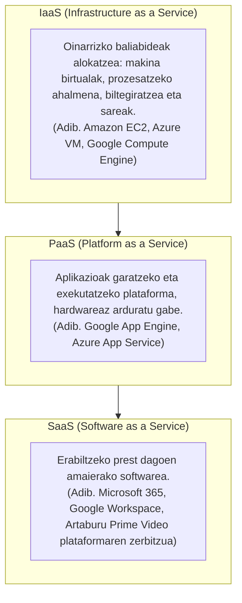

# Produkzio-Sektoreei Aplikatutako Digitalizazioa
## Navegazioa

- [Sarrera](Sarrera.md)
- [Datu base](Datu-base.md)
- [Digitalizazio](Digitalizazioa.md)
- [Markatze lengoaia](Markatze-lengoaia.md)
- [Sarea](sarea.md)
- [Sistemak](sistemak.md)
---

## 1. Digitalizazioaren Kontzeptua

**Digitalizazioa** enpresa eta erakunde baten prozesu, produktu, zerbitzu eta baliabide tradizionalak teknologia digitalen bidez eraldatzea da, informazioa formatu analogikotik digitalera igaroz, informazioa denbora errealean kudeatzeko, eraginkortasuna hobetzeko eta erabaki adimentsuak hartzeko.

Ekoizpen-sektoreetan, digitalizazioak datuetan oinarritutako kudeaketa ahalbidetzen du, produktibitatea handituz, kostu operatiboak murriztuz eta bezeroei zerbitzu pertsonalizatuagoak eskainiz (adibidez, gure kasuan *Artaburu Prime Video* plataformaren bidez edukien banaketa digitala kudeatuz).

### Enpresa bat digitalizatzeko oinarrizko pausoak:
1. **Dokumentu digitalak:** Paperetik formatu digitalera pasatzea.
2. **Prozesu automatizatuak:** Zeregin errepikakorrak automatizatzea.
3. **Komunikazio elektronikoa:** Barne eta kanpo komunikazio arina bermatzea.
4. **Hodeian biltegiratzea:** Datuak urrunetik seguru eta eskuragarri edukitzea.
5. **Merkataritza elektronikoa:** Online salmenta eta zerbitzu kanalak irekitzea.
6. **Datuen analisia:** Negozioaren errendimendua neurtzea eta optimizatzea.
7. **Gauzen interneta (IoT):** Ekipo fisikoak sarera konektatzea.
8. **Errealitate birtuala eta areagotua:** Mantentze-lanak eta formakuntza hobetzea.

---

## 2. IT eta OT Inguruneen Arteko Desberdintasunak

Industria eta enpresa modernoetan bi esparru teknologiko nagusi bereizten dira:

| Ezaugarria | IT (Information Technology) | OT (Operation Technology) |
| :--- | :--- | :--- |
| **Definizioa** | Informazioaren tratamendu, biltegiratze eta transmisio digitala kudeatzen du (enpresaren "garuna"). | Fabrika eta instalazioetako ekipo fisikoak, makineria eta prozesuak kontrolatzen ditu (enpresaren "besoak"). |
| **Helburu Nagusia** | Datuen konfidentzialtasuna, osotasuna eta eskuragarritasuna. | Eragiketen jarraitutasuna, langileen segurtasun fisikoa eta denbora errealeko erantzuna. |
| **Tipiko diren Sailak** | Zuzendaritza, Finantzak, Salmentak, Giza Baliabideak, IT Saila. | Ekoizpen-planta, Mantentze-lanak, Kalitate-kontrola, Biltegia eta Garraioa. |
| **Erabilitako Tresnak** | Ordenagailuak, zerbitzariak, datu-baseak, ERP, CRM, posta elektronikoa. | PLC-ak, SCADA sistemak, sentsoreak, CNC makinak, beso robotikoak. |
| **Ziklo-denborak** | Segundoak, minutuak edo orduak (onargarria da atzerapen txiki bat). | Milisegundoak edo mikrosegundoak (denbora erreala; geldialdiak galerak dakar). |

### IT eta OT Konbergentzia
Industria 4.0-an bi esparru hauek konektatzen dira: ekoizpen-makinek (OT) sortutako datuak denbora errealean bidaltzen zaizkie kudeaketa-sistemei (IT). Horrek eraginkortasuna biderkatzen du, baina **zibersegurtasun erronka berriak** sortzen ditu, fabrikako makinak sarera konektatzean kanpoko mehatxuen aurrean zaurgarriagoak baitira.

---

## 3. Teknologia Gaitzaile Digitalak (THD / TGD)

Teknologia Gaitzaile Digitalak 4.0 Industriaren oinarria dira, eraldaketa digitala ahalbidetuz eta negozio-eredu berriak sustatuz.

### 11 TGD Nagusiak:
1. **IoT (Gauzen Interneta):** Gailu fisikoak sarera konektatzea, datuak denbora errealean biltzeko eta ekintzak automatizatzeko (adib. sentsore bidez makinak automatikoki itzaltzea lanaldia amaitzean).
2. **IA / AA (Adimen Artifiziala):** Makinei ikasteko, arrazoitzeko eta erabakiak autonomoki hartzeko gaitasuna ematen dieten algoritmoak (adib. gomendio-motorrak).
3. **Big Data eta Datuen Analisia:** Datu-bolumen erraldoiak biltzeko, biltegiratzeko eta aztertzeko ahalmena, joerak aurreikusteko eta prozesuak hobetzeko.
4. **Cloud Computing (Hodeiko Konputazioa):** Datuak eta aplikazioak Internet bidezko urruneko zerbitzarietan ostatatzeko eta prozesatzeko aukera (AWS, Azure, Google Drive).
5. **Zibersegurtasuna:** Sareak, zerbitzariak eta datu sentikorrak baimenik gabeko atzipenetatik eta mehatxu zibernetikoetatik babesteko teknikak.
6. **Errealitate Birtuala eta Areagotua (VR / AR):** Ingurune erreala elementu digitalekin aberastea (AR) edo simulazio murgiltzaileak sortzea (VR) formakuntza eta mantentze-lanetarako.
7. **Blockchain (Bloke-katea):** Transakzioen erregistro banatu, deszentralizatu eta segurua, hornikuntza-katearen trazabilitatea bermatzeko bitartekaririk gabe.
8. **5G Konektibitatea:** Abiadura handiko eta latentzia minimoko sare mugikorrak, IoT eta ibilgailu autonomoak ahalbidetzen dituztenak.
9. **Robotika eta Automatizazioa:** Robot kolaboratiboak (Cobots) eta prozesuen automatizazio robotikoa (RPA), zeregin errepikakorrak edo arriskutsuak egiteko.
10. **3D Inprimaketa (Fabrikazio Gehigarria):** Objektu fisikoak geruzaz geruza sortzea material plastiko edo metalikoen bidez, prototipo azkarrak garatzeko.
11. **Biometria:** Pertsonen ezaugarri fisikoak (hatz-markak, aurpegia, ahotsa) erabiltzea autentifikazio eta segurtasun-kontroletarako.

### TGD-en Ezaugarri Nagusiak:
- **Moldakortasuna:** Hainbat arlotan aplika daitezke (bulegoan, tailerrean, logistikan).
- **Automatizazioa:** Zeregin asko giza esku-hartzerik gabe modu autonomoan burutzen dituzte.
- **Interkonexioa:** Sistemak elkarren artean komunikatzen dira datuak partekatuz.
- **Segurtasuna eta Eskalagarritasuna:** Datuen zifratzea bermatzen dute eta erakundearen hazkundearekin batera handitzeko gaitasuna dute.

### TGD-en Eragina Enpresan (IT eta OT):
- **IT Esparruan:** Datuen kudeaketa prediktiboa ahalbidetzen dute (audientzien segmentazioa, marketin pertsonalizatua eta bezeroen arreta azkarra).
- **OT Esparruan:** Fabrikako eragiketen kontrol zehatza ahalbidetzen dute (floten jarraipena denbora errealean eta ekoizpen-makinen mantentze prediktiboa).

### TGD-ak eta Ingurumena:
- **Ondorio Positiboak:** Paperaren erabilera murriztea (dokumentu digitalak), eraikinen eraginkortasun energetikoa hobetzea eta telelanari esker CO2 isurketak gutxitzea.
- **Ondorio Negatiboak:** Hondakin elektronikoen sorrera azkarra (e-waste), datu-zentroen energia-kontsumo altua eta lehengaien (mineralak) ustiapena.
- **Praktika Jasangarriak:** Ekipamenduen birziklapena sustatzea, hornidura berdea erabiltzea eta ekonomia zirkularra aplikatzea.

---

## 4. Cloudean Oinarritutako Sistemak (Cloud Computing)

Hodeian oinarritutako sistemak Internet bidez eskuragarri dauden baliabide informatikoak dira. Tokiko zerbitzari fisikoen mende egon beharrean, datuak urruneko datu-zentroetan biltegiratzen dira eta softwarea urrunetik exekutatzen da.

### Zergatik Hodeia? Datuak Galtzeko Arriskuak
Datuak ekipo lokal batean bakarrik gordetzeak arrisku handiak dakartza:
- **Giza akatsak:** Fitxategiak ustekabean ezabatzea edo gainidaztea.
- **Akats mekanikoak:** Disko gogorren matxura fisikoak, gainkargak eta deskarga elektrikoak.
- **Zibererasoak:** Malwarea, ransomwarea eta baimenik gabeko sarbideak.
- **Hodeiaren abantaila:** Segurtasun-kopia automatikoak eta datuen eskuragarritasun unibertsala bermatzen ditu.

### Eredu Tradizionala vs Cloud Computing:
| Alderdiak | Eredu Tradizionala | Cloud Computing |
| :--- | :--- | :--- |
| **Erantzuna** | Gailu lokalak eskaerei erantzuten die gordetako datuekin. | Datuak bistaratzeaz gain, programak hodeian exekutatzen dira. |
| **Biltegiratzea** | Gailu fisikoaren diskoaren ahalmenera mugatua. | Biltegiratze mugagabea eta eskalagarria, berehala handitzen dena. |
| **Atzipena** | Fitxategia gorde den ekipo fisikotik bakarrik. | Interneteko konexioa duen edozein gailu eta kokalekutatik. |
| **Eguneraketak** | Ekipoz ekipo eskuz instalatu eta eguneratu behar da. | Hornitzaileak zerbitzari zentralean automatikoki eguneratzen du. |

### Hodeiko Mailak (Hedapen Ereduak):
- **Hodei Publikoa:** Hornitzaile orokorrek kudeatutako azpiegitura partekatua (AWS, Azure, Google Cloud). Kostu baxuagoa eta eskalagarritasun handia.
- **Hodei Pribatua:** Erakunde bakar baten datu-zentroetan kokatutako azpiegitura esklusiboa. Datuen kontrol eta segurtasun maximoa.
- **Hodei Hibridoa:** Eredu publikoa eta pribatua konbinatzen ditu; datu kritikoak pribatuan babesten dira eta aplikazio orokorrak publikora bideratzen dira.

### Hodeiko Zerbitzu Ereduak:


### Hodeia Hobetzeko Arkitekturak: Latentzia Murriztea
Datuak urruneko datu-zentroetara bidaltzeak latentzia sor dezake. Horregatik, prozesamendua deszentralizatzen duten hiru geruza erabiltzen dira:
```
[ CLOUD COMPUTING ]   ---> Datu-zentro urruna (ahalmen gorena, latentzia altuagoa)
        |
  [ FOG COMPUTING ]   ---> Sare lokaleko nodoak eta zerbitzari hurbilak (tarteko latentzia)
        |
  [ MIST COMPUTING ]  ---> Sentsore-sareen mikrokontrolagailuak (oinarrizko datu-iragazketa)
        |
  [ EDGE COMPUTING ]  ---> Datu-iturrian bertan (adib. kamera adimentsua; latentzia zero)
```

1. **Edge Computing:** Prozesamendua gailuan bertan egiten da (adib. semaforo bateko kamerak irudiak bertan aztertzea milisegundotan).
2. **Fog Computing:** Edge eta Cloud-aren arteko tarteko geruza da; prozesamendua sare lokaleko nodo hurbiletan egiten da.
3. **Mist Computing:** Sentsore txikienetan bertan oinarrizko iragazketa egitea sarearen saturazioa saihesteko.

---

## 5. Proiektuaren Planifikazioa: GitHub Projects

Erronkaren antolaketa eta talde-lana digitalizatzeko **GitHub Projects** plataforma erabili da:
- **Metodologia:** Kanban taula interaktiboa.
- **Zutabeak:** `To Do` (Egin beharrekoak), `In Progress` (Garapen bidean), `In Review` (Egiaztatzen), `Done` (Amaituta).
- **Arduradunak:** Zeregin bakoitzari arduradun tekniko bat esleitu zaio (Iñigo: Sistemak, Telmo: Datu-baseak, Peru: Sareak, Hector: Markatze lengoaiak), proiektuaren trazabilitatea, koordinazioa eta gardentasuna bermatuz.
