# Webgunearen dokumentazioa

## 1. Sarrera

Dokumentu honetan webgunea osatzen duten HTML elementu nagusiak eta
diseinua kontrolatzeko erabiltzen den CSS kodea azaltzen dira. Webguneak
hainbat atal ditu, eta goiko nabigazio-menuaren bidez atal batetik
bestera joan daiteke erabiltzailea.

## 2. Webgunearen egitura

Webgunearen egitura nagusia HTML etiketen bidez antolatuta dago. Atal
nagusiak hauek dira:

-   **`<header>`**: webgunearen goiko zatia da. Bertan webgunearen izena
    edo marka eta nabigazio-menua agertzen dira.
    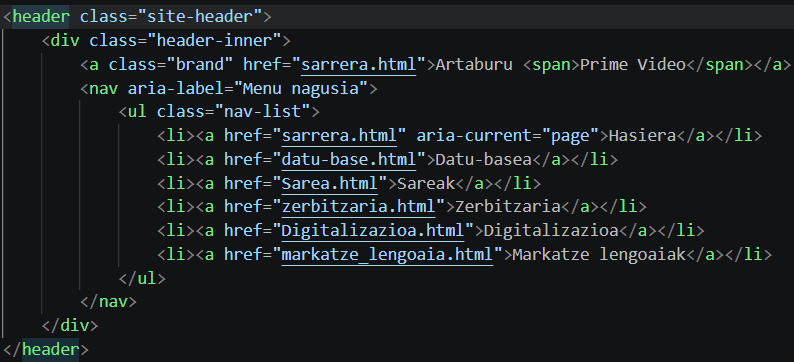
-   **`<nav>`**: nabigazio-menua biltzen du. Menu horretako estekek
    webguneko beste orri batzuetara eramaten dute.
-   **`<main>`**: orriaren eduki nagusia gordetzen du.
    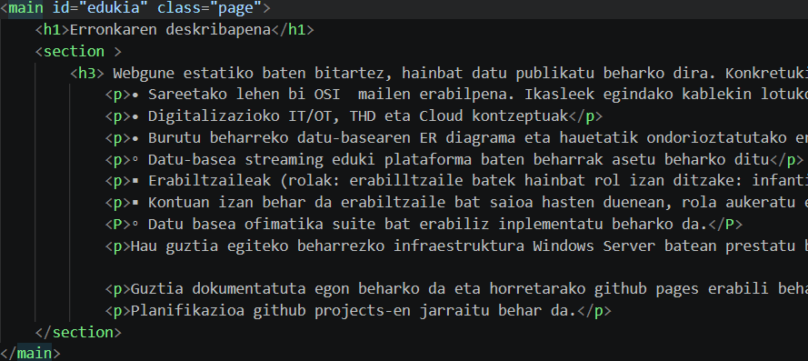
-   **`<section>`**: edukia ataletan banatzeko erabiltzen da.
-   **`<article>`**: bere kabuz uler daitekeen eduki-bloke bat
    antolatzeko erabil daiteke.
-   **`<footer>`**: orriaren beheko zatia da. Harremanetarako
    informazioa eta taldeari buruzko datuak jartzeko erabiltzen da.
    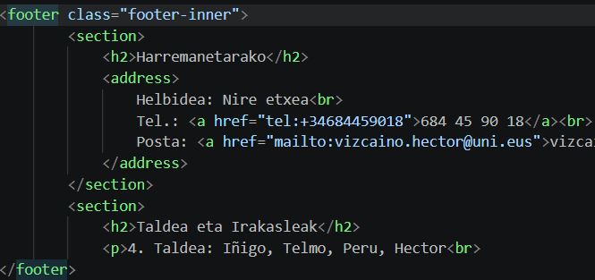

HTML elementu semantiko horiei esker, kodea antolatuagoa eta ulertzeko
errazagoa da.

## 3. Goiburua eta nabigazio-menua

Goiburua (`<header>`) webgunearen goialdean dago. Bertan, **Arta(b)uru
prime video** izena agertzen da, eta horren ondoan nabigazio-menua dago.

Menuan, besteak beste, honako ataletarako estekak agertzen dira:

-   Hasierara
-   Datu-basea
-   Sarea
-   Zerbitzaria
-   Digitalizazioa
-   Markatze-lengoaia
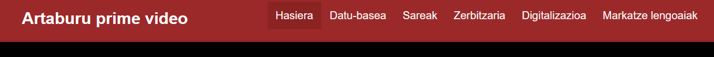

Estekak HTMLko **`<a>`** etiketarekin sortzen dira. `href` atributuak
estekak zein HTML fitxategi edo helbidetara joan behar duen adierazten
du. Adibidez:

``` html
<a href="datu-base.html">Datu-basea</a>
```

Menuan `aria-label` edo `aria-current` bezalako atributuak ere erabil
daitezke. Horiek nabigazioa hobeto deskribatzen eta irisgarritasuna
hobetzen laguntzen dute.

## 4. Eduki nagusia eta izenburuak

Eduki nagusia **`<main>`** elementuaren barruan dago. Atalak
antolatzeko, `<section>` eta `<article>` elementuak erabiltzen dira.

Izenburuak hierarkikoki antolatzen dira:

-   **`<h1>`**: orriaren izenburu nagusia da.
    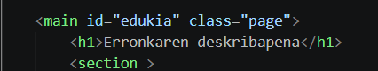
-   **`<h2>`**: atal nagusien izenburuetarako erabiltzen da.
    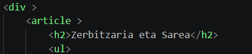
-   **`<h3>`**: azpiatalak edo maila txikiagoko izenburuak adierazteko
    erabiltzen da.
    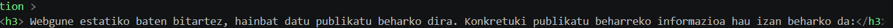

Izenburu-mailak ordenan erabiltzea komeni da, edukiaren egitura argia
izan dadin. Adibidez, orri batean `<h1>` bat egon daiteke, eta haren
azpian hainbat `<h2>` eta `<h3>`.

## 5. Testua eta zerrendak

Informazioa azaltzeko, HTMLko paragrafoak erabiltzen dira, hau da,
**`<p>`** etiketak. Testua atal txikietan banatzeak irakurketa errazten
du.

Elementuak zerrenda batean aurkezteko, bi etiketa mota erabiltzen dira:

-   **`<ul>`**: ordenarik gabeko zerrenda sortzen du.
-   **`<li>`**: zerrendako elementu bakoitza adierazten du.
    

Adibidea:

``` html
<ul>
  <li>Partizio-taula</li>
  <li>Bolumen sinplea</li>
  <li>RAID 1 ispilua</li>
</ul>
```
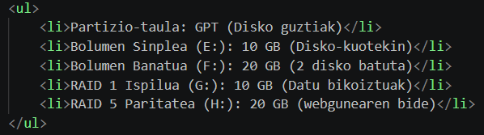

Zerrenda mota hori erabilgarria da hainbat kontzeptu edo ezaugarri modu
argian aurkezteko.

## 6. Irudiak

Irudiak txertatzeko **``** etiketa erabiltzen da. `src` atributuak
irudiaren fitxategiaren kokapena adierazten du, eta `alt` atributuak
irudiaren ordezko deskribapena ematen du.

Adibidea:

``` html

```
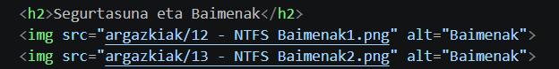

Irudiak karpeta batean gordetzen badira, `src` atributuko bidea
karpetaren eta fitxategiaren izenarekin bat etorri behar da.
Fitxategi-izenetan letra larriak, letra xeheak, espazioak eta luzapenak
ondo idatzi behar dira; bestela, irudia ez agertzea gerta daiteke
webgunea zerbitzari batean argitaratzean.

## 7. Taulak

Datuak errenkada eta zutabeetan antolatzeko, HTMLko taulak erabiltzen
dira:

-   **`<table>`**: taula sortzen du.
-   **`<thead>`**: taularen goiburuko errenkadak biltzen ditu.
-   **`<tbody>`**: taularen datuak biltzen ditu.
-   **`<tr>`**: errenkada bat adierazten du.
-   **`<th>`**: goiburuko gelaxka bat adierazten du.
-   **`<td>`**: datu arrunt baten gelaxka adierazten du.

Adibideetan, taulak `data-table` klasea dauka:

``` html
<table class="data-table">
  <thead>
    <tr>
      <th>Elementua</th>
      <th>Informazioa</th>
      <th>Argazkia</th>
    </tr>
  </thead>
  <tbody>
    <tr>
      <td>Adibidea</td>
      <td>Azalpena</td>
      <td>Irudia</td>
    </tr>
  </tbody>
</table>
```

Taulak informazioa modu ordenatuan konparatzeko edo aurkezteko balio du.
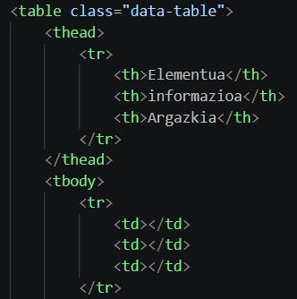

## 8. CSS eta `class` atributua

CSS erabiltzen da webgunearen itxura zehazteko: koloreak, neurriak,
ertzak, tarteak eta elementuen kokapena, besteak beste.

HTML elementu bati **`class`** atributua gehitzen zaio estilo jakin bat
aplikatzeko. Adibidez:

``` html
<table class="data-table">
```

CSS fitxategian, klase hori puntu batekin idazten da:

``` css
.data-table {
  width: 100%;
  border-collapse: collapse;
  background: black;
}
```
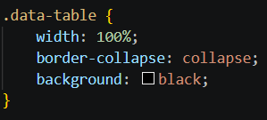
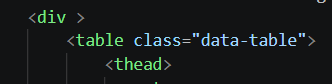

Kode horretan:

-   `width: 100%` propietateak taulari edukiontziaren zabalera osoa
    hartzeko esaten dio.
-   `border-collapse: collapse` propietateak taularen gelaxken ertzak
    elkartzen ditu.
-   `background: black` propietateak atzeko planoa beltz jartzen du.

Klaseek estilo bera elementu bati baino gehiagori aplikatzea
ahalbidetzen dute. Klase baten izena HTMLn eta CSSn berdin idatzi behar
da.

## 9. Oina eta harremanetarako informazioa

**`<footer>`** elementua orriaren behealdeko informazioa biltzeko
erabiltzen da. Adibideetan, harremanetarako datuak eta taldeari edo
ikasleei buruzko informazioa agertzen dira.

Helbide elektroniko bati esteka egiteko, `mailto:` erabil daiteke;
telefono-zenbaki bati deitzeko esteka egiteko, berriz, `tel:`:

``` html
<a href="mailto:adibidea@posta.eus">Bidali posta elektronikoa</a>
<a href="tel:+34123456789">Deitu</a>
```
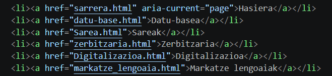

Adibideko helbideak ordezkatu egin behar dira webgunean benetako
harremanetarako datuak jarri behar badira.

## 10. Fitxategien antolaketa eta argitaratzea

Webguneak HTML fitxategiak, CSS fitxategia eta irudien karpeta izan
ditzake. Fitxategien arteko bideak zuzenak direla egiaztatu behar da.

Webgunea GitHub Pages bezalako zerbitzu batean argitaratzean, kontuan
hartu beharrekoak:

1.  Esteketako fitxategi-izenak benetako izenekin bat etortzea.
2.  Letra larriak eta xeheak errespetatzea.
3.  Irudien karpetaren eta fitxategien bideak zuzenak izatea.
4.  HTML orriek CSS fitxategia behar bezala lotuta edukitzea.
5.  Nabigazio-menuan estekatutako orri guztiak biltegian egotea.

Ordenagailuan lokalki funtzionatzen duen orri batek akatsak izan ditzake
argitaratutako bertsioan, fitxategi-izenak edo bideak ez badatoz bat
zehazki.
