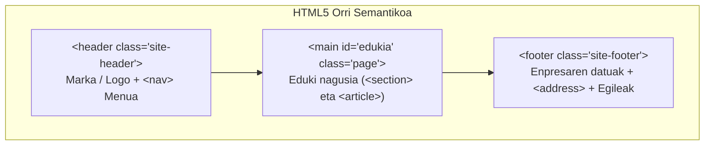

# Markatze Lengoaiak: Webgunearen Egitura eta Estiloak

---

## 1. Webgunearen Egitura Semantikoa (HTML5)

Proiektu honetan garatutako webgunea (**Artaburu Prime Video**) HTML5 estandarrak zorrotz jarraituz eraiki da. Orrialde guztiek egitura semantiko homogeneo eta irisgarria dute, hiru atal nagusitan banatuta:



1. **`<header>` (Goiburua):**
   - Plataformaren marka korporatiboa (`Artaburu Prime Video`).
   - `<nav aria-label="Menu nagusia">`: Orrien arteko nabigazio-menua zerrenda ez-ordenatu batean (`<ul>`, `<li>`), esteka bakoitzak dagokion orrira bideratuz.
   - `aria-current="page"` atributua uneko orria erabiltzaileari eta pantaila-irakurleei nabarmentzeko.

2. **`<main id="edukia">` (Eduki Nagusia):**
   - Orri bakoitzaren funtsezko edukia gordetzen du.
   - `<section>`: Atal tematiko nagusiak definitzeko (sarrera, katalogoa, taulak, formularioko guneak).
   - `<article>`: Eduki autonomoak eta txartelak (filmak, serieak, dokumentalak, planak).

3. **`<footer>` (Orri-oina):**
   - Enpresaren informazio orokorra.
   - `<address>`: Harremanetarako bide ofizialak (posta elektronikoa eta telefonoa `mailto:` eta `tel:` estekekin).
   - 4. Taldeko partaideen izenak eta egile-eskubideen oharra.

---

## 2. Erabilitako HTML Elementu Teknikoak

Rúbrikak eskatzen dituen elementu guztiak inplementatu dira:

| Elementua | Erabilera / Funtzioa | Kokapena Webgunean |
| :--- | :--- | :--- |
| `<h1>` &ndash; `<h3>` | Izenburuen hierarkia semantikoa (mailak salto egin gabe) | Orrialde guztietan |
| `<ul>`, `<ol>`, `<li>` | Zerrenda ordenatuak (urratsak) eta desordenatuak (menua, ezaugarriak) | Menua, txartelak eta gidak |
| `<table>`, `<thead>`, `<tbody>`, `<tr>`, `<th>`, `<td>` | Datu teknikoak taularatzeko (planen prezioak, datu-baseko taulak, elementuen laburpena) | `Datu-base.html`, `markatze_lengoaia.html` |
| `` | Irudiak eta kartelak, beti `alt` testu deskribatzailearekin | Hasiera (karrusela eta katalogoa) |
| `<a>` | Barne-estekak, orrien arteko jauziak eta kanpoko estekak | Nabigazio-menua eta footer-a |
| `<form>`, `<input>`, `<select>`, `<button>` | Saioa hasteko eta streaming-eko profila aukeratzeko formularioa | `index.html` (Saioa hasi) |
| `<address>` | Kontakturako informazio semantikoa | Orri guztietako oina |

---

## 3. Estilo Orriak eta Kutxa Eredua (CSS3)

Estilo guztiak kanpoko fitxategi bakar batean antolatuta daude ([`style.css`](../HTML_4_taldea/style.css)), estiloak zuzenean HTML etiketetan txertatzea saihestuz (*no inline styles*).

### A. Aldagai Korporatiboak (`:root`)
Diseinu koherentea bermatzeko CSS aldagaiak erabiltzen dira:
```css
:root {
    --gorria: #9b2929;
    --gorri-iluna: #6e1c1c;
    --beltza: #000;
    --txartela: #1f1f1f;
    --testua: #f2f2f2;
    --urrea: #e8b04a;
    --berdea: #4cc27a;
    --ertza: #333;
    --borobila: 8px;
    --zabalera: 1000px;
}
```

### B. Kutxa-Eredua (Box Model)
Elementu bakoitzaren neurriak eta espazioak doitzeko kutxa-ereduaren propietate nagusiak erabili dira:
- `box-sizing: border-box`: Elementu guztietan ezarrita neurrien kalkulua zehatza izan dadin (`*`, `*::before`, `*::after`).
- `margin`: Txartelen, atalen eta taulen arteko kanpo-banaketa kontrolatzeko.
- `padding`: Edukiaren eta ertzen arteko barne-tartea ziurtatzeko (adibidez, txarteletan `padding: 20px`).
- `border` eta `border-radius`: Ertz finak (`border: 1px solid var(--ertza)`) eta ertz biribilduak (`border-radius: var(--borobila)`).

### C. Diseinu Moldagarria (Flexbox eta Grid)
- **Flexbox (`display: flex`):** Nabigazio-menuan, orri-oinean eta zutabe anitzeko banaketetan erabili da elementuak lerrokatzeko.
- **CSS Grid (`display: grid`):** Txartelen sareta dinamikoetan (`grid-template-columns: repeat(auto-fit, minmax(260px, 1fr))`), pantailaren zabalerara automatikoki egokitzen dena.
- **Media Queries (`@media (max-width: 768px)`):** Pantaila txikietan (mugikorrak) menua zutabe bertikalean jartzen da eta alboko gortinak ezkutatzen dira irakurgarritasuna lehenesteko.

### D. Karrusela (CSS Purua)
Hasierako orriko karrusela JavaScript liburutegirik gabe programatu da, CSS `@keyframes` animazioen bidez, errendimendu handiagoa lortzeko.

---

## 4. Irisgarritasuna (Web Accessibility)

Webguneak irisgarritasun unibertsalaren oinarriak betetzen ditu:
1. **Hizkuntza deklarazioa:** `html lang="eu"` orri guztietan.
2. **Jauzi-esteka (`.skip-link`):** Teklatu bidez nabigatzen duten pertsonek menua saltatu eta zuzenean eduki nagusira joateko aukera (`href="#edukia"`).
3. **Foku ikusgarria (`:focus-visible`):** Teklatuko `Tab` tekla sakatzean urre koloreko eskema garbia erakusten da.
4. **Kontraste handia:** Letra argiak (`#f2f2f2` eta `#e8b04a`) hondo ilunaren gainean (`#000` eta `#1f1f1f`).
5. **Formularioko etiketak:** Eremu bakoitzak bere `<label for="...">` lotura esplizitua du.
6. **Mugimendu murriztua:** `@media (prefers-reduced-motion: reduce)` errespetatzen da animazioak geldiaraziz.
