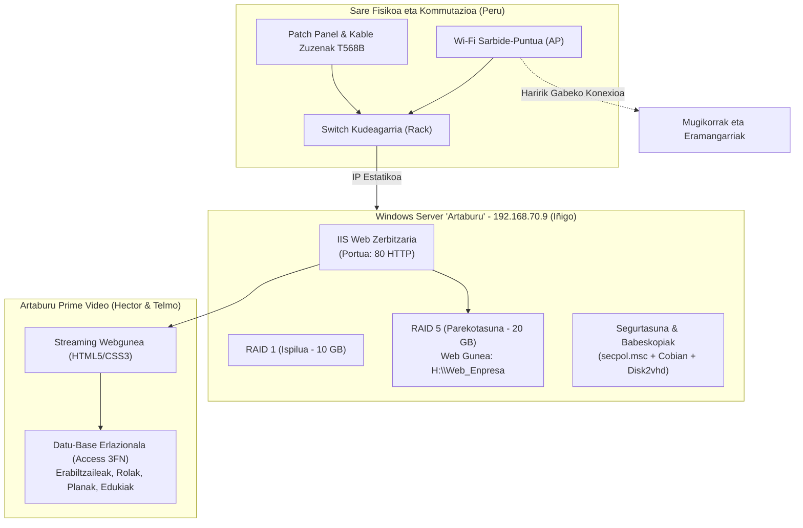

# 1. Erronka: Informazioaren Digitalizazio Webgunea
## Navegazioa

- [Sarrera](Sarrera.md)
- [Datu base](Datu-base.md)
- [Digitalizazio](Digitalizazioa.md)
- [Markatze lengoaia](Markatze-lengoaia.md)
- [Sarea](sarea.md)
- [Sistemak](sistemak.md)

**Taldea:** 4. Taldea  
**Zikloa:** Sareko Informatika Sistemen Administrazioa (SISA 1) &mdash; 1. Maila  
**Ikastetxea:** Uni Eibar-Ermua  
**Ikasturtea:** 2026-2027  

---

## 1. Proiektuaren Deskribapena

**Taldea:** 4. Taldea  
**Zikloa:** Sareko Informatika Sistemen Administrazioa (SISA 1) &mdash; 1. Maila  
**Ikastetxea:** Uni Eibar-Ermua  
**Ikasturtea:** 2026-2027  

Erronka honen helburua enpresa baten azpiegitura informatikoa berritzea eta modernizatzea da. Proposamen tekniko guztiak aurkezteko eta bezeroei zerbitzua emateko, **Artaburu Prime Video** streaming multimedia plataforma garatu dugu.

Plataforma hau enpresaren Windows Server zerbitzari propioan (**IIS**) dago argitaratuta, eta proiektuaren dokumentazio tekniko osoa hodeian (**GitHub Pages**) kudeatzen da, sareko lau arlo nagusiak integratuz: **Sistemak**, **Datu-Baseak**, **Sareak**, **Digitalizazioa** eta **Markatze Lengoaiak**.

---

## 2. Taldekideak eta Eginkizunak

| Taldekidea | Modulua | Eginkizun Nagusiak |
| :--- | :--- | :--- |
| **Iñigo Lizarralde** | **Sistema Eragileak** | Windows Server 2022 instalazioa, IP estatikoa (`192.168.70.9`), IIS Web Zerbitzaria, RAID 1 eta RAID 5 biltegiratzea, disko-kuotak, segurtasun-politikak (`secpol.msc`) eta babeskopia automatikoak (Cobian Reflector eta Disk2vhd). |
| **Telmo** | **Datu-Baseak** | Streaming plataformaren azterketa, Entitate/Erlazio (E-R) diseinua, **ISA hierarkia** (Pelikulak, Serieak, Dokumentalak), eredu erlazional normalizatua (3FN) eta Microsoft Access-eko inplementazio fisikoa balidazio-arauekin. |
| **Peru** | **Sareak** | OSI ereduaren 1. eta 2. mailak: kableatu egituratua (T568B), patch panel-a eta switch-a, pasahitza ASCII bitarrera bihurtzea, **CRC-6-GSM** polinomio bidezko errore-kalkulua, modulazio digitalak (ASK, FSK, PSK), Manchester kodetzea eta Wi-Fi proba. |
| **Hector** | **Markatze Lengoaiak** | Webgune korporatiboaren garapena HTML5 semantikoan, estilo-orri zentralizatua (CSS3), kutxa-eredua, Flexbox eta Grid diseinu moldagarria, karrusel animatua, irisgarritasuna (WCAG) eta GitHub Pages dokumentazioa. |
| **Talde Osoa** | **Digitalizazioa** | IT eta OT inguruneen analisia, 11 Teknologia Gaitzaile Digitalak (THD), Cloud ereduak (IaaS, PaaS, SaaS, Edge/Fog/Mist) eta GitHub Projects bidezko plangintza digitala (Kanban). |

---

## 3. Dokumentazio Teknikorako Aurkibidea

Hemen dituzu modulu bakoitzeko txosten tekniko zehatzak:

* 🖥️ **[Sistemak: Windows Server, RAID eta IIS](sistemak.md)** &mdash; Zerbitzariaren konfigurazio osoa eta 22 pantaila-argazkiak.
* 🗄️ **[Datu-Baseak: Streaming Plataforma eta Access](<Datu base.md>)** &mdash; E-R diagrama, ISA hierarkia, 3FN normalizazioa eta Access fitxategia.
* 🌐 **[Sareak: Azpiegitura Fisikoa, CRC eta Modulazioak](sarea.md)** &mdash; Kableak, switch-a, ASCII bihurketa, CRC-6-GSM zatiketa eta seinaleak.
* ☁️ **[Digitalizazioa: IT/OT, THD eta Cloud Computing](Digitalizazioa.md)** &mdash; Kontzeptu industrialak, hodei mailak eta Kanban plangintza.
* 🎨 **[Markatze Lengoaiak: Webgunea eta Irisgarritasuna](<Markatze lengoaia.md>)** &mdash; HTML5 egitura, CSS estiloak eta irisgarritasun arauak.

---

## 4. Azpiegitura Orokorraren Eskema

---

## 5. Webgunerako Sarbidea

1. **Sare Lokalean (Windows Server IIS bidez):**
   - Nabigatzailean: `http://192.168.70.9` (edo gelako Wi-Fira konektatuta).
2. **Hodeian (GitHub Pages bidez):**
   - Biltegia: [Robonian3000/WebErronka.github.io](https://github.com/Robonian3000/WebErronka.github.io)
   - Webgunea: [weberronka.github.io](https://weberronka.github.io)
