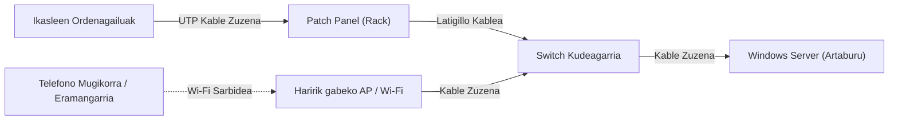

# Sareen Planifikazioa eta Kudeaketa: OSI Ereduaren 1. eta 2. Mailak

---

## 1. Azpiegitura Fisikoa eta OSI Eredua

Sarearen azpiegitura fisikoak OSI ereduaren lehenengo bi geruzak hartzen ditu barne:
- **1. Maila (Geruza Fisikoa):** Seinaleen transmisioa, kableatu fisikoa, konektoreak eta tentsio-mailak.

Maila fisikoan 3 zati daude, kableen **arrak**, **emeak** eta **patch panel erako konexioa**.

<br>

- **Hemen emea nola egiten den ikusten da**

| | |
|:---:|:---:|
|  <br> kablea zuritu behar da |  <br> gero kabletxo bakoitza banatu
|  <br> kable bakoitza bere tokian jarri |  <br> azkenik presionatu  inpaktuko krinpagailuarekin

<br>

- **Hemen arra nola egiten den ikusten da**

| | |
|:---:|:---:|
|  <br> lehenik kablea zuritu |  <br> gero kabletxo bakoitza banatu
|  <br> kabletxoak ordenean jarri eta moztu |  <br> azkenik sartu rj45 buruan eta krinpatu

<br>

- **eta azkenik Hemen patch panel eko konexioa nola egiten den ikusten da**

| | |
|:---:|:---:|
|   | 
|  |

- **patch panel-eko konexioak egiteko kabletxo bakoitza bere kolorean jarri eta inpaktuko krinpagailuarekin presioa egin**

<br>

- **2. Maila (Datu-Loturaren Geruza):** Helbideratze fisikoa (MAC helbideak), kommutazioa (Switch-a), erroreen detekzioa (CRC) eta markoen kudeaketa.



### Kableatu Egituratua eta Konexioak
1. **Kable Zuzena (Direct Cable - T568B):**
   - Bi muturretan T568B araua jarraitzen du (Zuri-Laranja, Laranja, Zuri-Berdea, Urdina, Zuri-Urdina, Berdea, Zuri-Marroia, Marroia).
   - Ekipo ezberdinak konektatzeko erabilia: Ordenagailua &rarr; Patch Panel, eta Patch Panel &rarr; Switch.
2. **Kable Gurutzatua (Crossover Cable):**
   - Mutur batean T568A eta bestean T568B. Ekipo berdinak elkarrekin lotzeko (PC &rarr; PC edo Switch zaharra &rarr; Switch).
3. **Kontsola Kablea (Rollover / Console Cable):**
   - Switch-aren kontsola-portura sartzeko eta kudeaketa-komandoak (CLI) exekutatzeko erabilia.
4. **Patch Panel eta Switch:**
   - Patch panel-ak ikasgelako hormetako eta mahaietako hartuneak antolatzen ditu. Bertatik latigillo laburren bidez switch-eko ataketara bideratzen dira konexioak, mantentze-lanak erraztuz.

---

## 2. Pasahitzaren ASCII Kodifikazioa

Windows Serverreko segurtasun-politikan ezarritako pasahitz konplexua hartu da oinarritzat: **`Admin123@`**.  
Pasahitz honek gutxieneko 8 karaktere, maiuskulak, minuskulak, zenbakiak eta ikur berezi bat ditu.

ASCII kode estandarraren arabera (8 bit / karaktere bakoitzeko), ondorengo bihurketa burutu da:

| Karaktere | ASCII Balio Hamartarra | Balio Bitarra (8 bit) |
| :---: | :---: | :---: |
| **A** | 65 | `01000001` |
| **d** | 100 | `01100100` |
| **m** | 109 | `01101101` |
| **i** | 105 | `01101001` |
| **n** | 110 | `01101110` |
| **1** | 49 | `00110001` |
| **2** | 50 | `00110010` |
| **3** | 51 | `00110011` |
| **@** | 64 | `01000000` |


**Transmititu beharreko mezu bitar osoa ($M$):**
`01000001 01100100 01101101 01101001 01101110 00110001 00110010 00110011 01000000`

---

## 3. CRC-6-GSM Errore-Detekzioaren Kalkulua

Transmisioan gerta daitezkeen erroreak hautemateko, erredundantzia ziklikoaren kodeketa (**CRC - Cyclic Redundancy Check**) aplikatu da, GSM estandarreko 6 graduko polinomioa erabiliz.

### Polinomio Sortzailea:
$$G(x) = x^6 + x^5 + x^3 + x^2 + x + 1$$

Polinomioaren koefiziente bitarrak:
- $x^6 \rightarrow 1$
- $x^5 \rightarrow 1$
- $x^4 \rightarrow 0$ (ez dagoenez 0 da.)
- $x^3 \rightarrow 1$
- $x^2 \rightarrow 1$
- $x^1 \rightarrow 1$
- $x^0 \rightarrow 1$

Divisorea: **`1 1 0 1 1 1 1`** (7 bit, beraz $k = 6$ zero gehituko zaizkio mezuari zatiketa egiteko).

### Kalkulu Prozedura Urratsez Urrats:
1. **Zeroak gehitzea:** Jatorrizko mezuari 6 zero eransten zaizkio amaieran ($M(x) \cdot x^6$).
2. **Modulo-2 Zatiketa (XOR):**
   - Zatiketa binarioa egiten da XOR eragiketa aplikatuz (bit berdinak = 0, bit ezberdinak = 1; ez dago eramaterik/acarreo).
   - Zatikizunaren lehen bita `1` denean, zatitzailea azpian jartzen da eta XOR egiten da.
   - Lehen bita `0` denean, eskuinera mugitzen da hurrengo `1` bita aurkitu arte.
3. **Hondarra ($R$):** Zatiketa amaitzean lortzen den 6 biteko hondarra da, Gure kasuan **001001** da.
4. **Transmititutako Kodetutako Mezua:** Jatorrizko mezuari kalkulatutako 6 biteko hondarra gehitzen zaio amaieran: $T(x) = M(x) \cdot x^6 \oplus R(x)$. Hartzaileak mezu bera jasotzean polinomio berarekin zatituko du; hondarra `000000` bada, mezua osorik eta errorerik gabe iritsi dela bermatzen da.

<br>

[Kalkulu orrian eginda](https://docs.google.com/spreadsheets/d/1HKA2vaXFDSeuvVC_ZqdlqpXQHusKf2Zk/edit?usp=drive_link&ouid=105279118248341423475&rtpof=true&sd=true)

<br>

[Kalkulu orrian verifikatuta](https://docs.google.com/spreadsheets/d/1CP1PdVYuvN1_hyWiGUnZD6gbDN7MnA17/edit?usp=drive_link&ouid=105279118248341423475&rtpof=true&sd=true)


---

## 4. Modulazio Digitalak (ASK, FSK, PSK)

Bitarrezko seinalea sareko euskarri fisikotik (uhin bidez edo kablez) garraiatzeko seinale garraiatzaile baten parametroak modulatzen dira:

```
Mezua:  | 0 | 1 | 0 | 0 | 0 | 0 | 0 | 1 | 0 | 1 | 1 | 0 | 0 | 1 | 0 | 0 | 0 | 1 | 1 | 0 | 1 | 1 | 0 | 1 | 0 | 1 | 1 | 0 | 1 | 0 | 0 | 1 | 0 | 1 | 1 | 0 | 1 | 1 | 1 | 0 | 0 | 0 | 1 | 1 | 0 | 0 | 0 | 1 | 0 | 0 | 1 | 1 | 0 | 0 | 1 | 0 | 0 | 0 | 1 | 1 | 0 | 0 | 1 | 1 | 0 | 1 | 0 | 0 | 0 | 0 | 0 | 0 | 0 | 0 | 1 | 0 | 0 | 1 |
```

1. **ASK (Amplitude Shift Keying - Anplitude Modulazioa):**
   - `1` bita: Anplitude handiko seinalea ($A_1$).
   - `0` bita: Anplitude txikiko seinalea edo anplitude nulua ($A_0 = 0$).
   - Zarata elektrikoarekiko sentikorrena da.
2. **FSK (Frequency Shift Keying - Maiztasun Modulazioa):**
   - `1` bita: Maiztasun altuko uhina ($f_1$, uhin trinkoagoak).
   - `0` bita: Maiztasun baxuko uhina ($f_0$, uhin zabalagoak).
   - Anplitudea konstante mantentzen denez, zarataren aurrean ASK baino sendoagoa da.
3. **PSK (Phase Shift Keying - Fase Modulazioa):**
   - `1` bita eta `0` bita adierazteko seinalearen fasea 180º aldatzen da (uhina goitik hasi beharrean behetik hasten da).
   - Banda-zabalera hobekien aprobetxatzen duen modulazio metodoa da.
  


  **Paperean eginda:**
 -ASK(2)-FSK(2).jpg>)
   **Ordenagailuan garbira pasatuta:**
 

---

## 5. Manchester Lerro-Kodetzea

Datu-loturaren geruzan seinale digitala sinkronizatzeko **Manchester kodifikazioa** erabiltzen da (Ethernet sareen oinarria):
- **Trantsizio araua:** Bit bakoitzaren erdian beti trantsizio bat gertatzen da. Horri esker, igorlearen eta hartzailearen erlojuak automatikoki sinkronizatuta mantentzen dira.
- **`0` Bitarra:** Behetik gorako trantsizioa (Low &rarr; High).
- **`1` Bitarra:** Goitik beherako trantsizioa (High &rarr; Low).
- **Abantaila:** Seinaleak ez du osagai jarraiturik (DC) metatzen eta akatsak berehala detektatzen dira erdiko trantsiziorik ez badago.

<br>

- **argazkiko lehen grafikoa manchester-a da**
- **argazkiko bigarren grafikoa clock-a da**
- **argazkiko hirugarren grafikoa diferentziala da**

---

## 6. Haririk Gabeko Egiaztapena (Wi-Fi Proba)

Rúbrikaren gutxieneko baldintza betez, sareko azpiegitura hari gabeko gailu baten bidez probatu da:
1. Gelako Wi-Fi sarbide-puntua (Access Point) switch-eko ataka batera konektatu da.
2. Telefono mugikor bat konektatu da Wi-Fi sare horretara, DHCP bidez `192.168.70.x` segmentuko IP bat jasoz.
3. Mugikorreko nabigatzailean Windows Serverreko IIS zerbitzariaren IP helbidea sartu da:
   ```
   http://192.168.70.9
   ```
4. Webgunea arrakastaz kargatu da mugikorrean, sareko kableatu fisikoa, kommutazioa, Wi-Fi bideratzea eta zerbitzariaren web-ostalaritza (IIS) elkarrekin modu egokian komunikatzen direla frogatuz.
